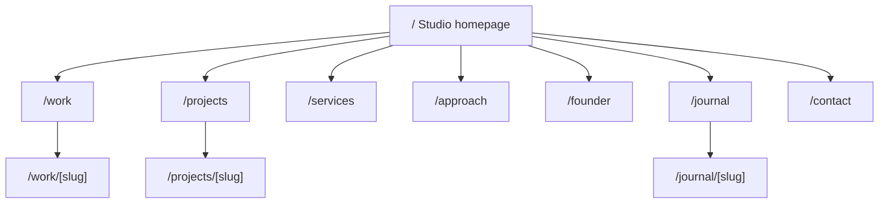

# 04 — Information Architecture

**Objective.** Define every page's purpose, content order and relationships so navigation and SEO follow from structure.
**Status:** structure `PROPOSED` (based on the brief's draft). Page copy requires approval.

## 4.1 Evaluation of the proposed structure
| Question | Assessment | Recommendation |
|---|---|---|
| Is `/work` vs `/projects` clear? | Needs a rule or visitors will not know where to look | Adopt the ownership rule in §4.3 and label `/projects` "Products & experiments" in the UI |
| Is `/approach` separate from `/services` worthwhile? | Yes for the scroll-linked methodology; but thin if standalone | Keep, and cross-link; the homepage methodology section is the teaser |
| Is `/journal` a launch requirement? | An empty journal harms credibility | **Optional at launch.** Ship it only with ≥ 2 genuine articles; otherwise hide from nav |
| Missing pages | Legal and error states | Add `/privacy`, `/404`, `/sitemap.xml`, `/robots.txt` (non-nav) |
| Founder discoverability | Brief wants "discover naturally" | Link from hero byline, founder section, project credits, article bylines, footer. Not a primary nav item label "About" |

## 4.2 Sitemap

Full diagram with cross-links: `DIAGRAMS/sitemap.mmd`.

## 4.3 Studio work vs client projects vs owned products
| Type | Definition | Lives at | Attribution rule |
|---|---|---|---|
| **Client work** | Built for a third party who owns the result | `/work` | Client named only with permission; HafTech role and scope stated |
| **Studio work** | Built under the HafTech name, e.g. internal systems or productised services | `/work` | HafTech is owner; contributors listed |
| **Owned products** | Independently owned by HafTech or the founder | `/projects` | Ownership entity stated; status mandatory |
| **Experiments** | Technical explorations, no commitment to ship | `/projects` | Marked "Exploring" |

Rule of thumb: **if someone else owns it, it is `/work`; if we own it, it is `/projects`.** Founder-owned items shown on `/founder` must state "independently developed by Faruq Ariyo" if not owned by HafTech (ownership of each is `OPEN`, see doc 08).

## 4.4 Navigation model
- Primary: **Work · Projects · Services · Approach · Founder · Contact** (Journal added when launched).
- Desktop: top bar with wordmark left, index right. Mobile: full-screen overlay menu, 48 px targets.
- Footer: full sitemap, contact email, social links, privacy, copyright.
- Breadcrumb on detail pages: `Work / Project name`.

## 4.5 Page specifications
Format per page: objective · visitor · primary question · content hierarchy · section sequence · visual composition · interaction · motion · mobile · CTA · SEO · relationships.

### `/` Studio homepage
1. **Objective:** state what HafTech is and move the visitor to Work or Contact. 2. **Visitor:** prospective client, collaborator. 3. **Question:** "What is this studio and is it credible?" 4. **Hierarchy:** positioning → philosophy → proof → capability → process → people → action. 5. **Sequence:** 8 sections, see doc 05. 6. **Composition:** asymmetric editorial grid, hairline rules, index numerals. 7. **Interaction:** architecture explorer, capability accordion. 8. **Motion:** line-drawing hero, text reveals, scroll-linked methodology. 9. **Mobile:** single column, hero legible without animation, diagram becomes a layer list with tap-to-expand. 10. **CTA:** "Start a project" and "See the work". 11. **SEO:** title "HafTech — Software engineering studio", unique meta description, Organization + WebSite JSON-LD. 12. **Relationships:** links to every top-level page.

### `/work`
Objective: browse client and studio work. Visitor: client evaluating fit. Question: "Have they built something like mine?" Hierarchy: filter by type/status → feature list. Sequence: intro line → editorial index (list view default, image on hover/tap) → closing CTA. Composition: large alternating features, never uniform cards. Interaction: filter chips (keyboard operable), image preview. Motion: image mask reveal, list hover (touch: tap-expand). Mobile: stacked features, 16:10 crops. CTA: "Discuss a project". SEO: CollectionPage; each item links to case study. Relations: `/work/[slug]`, `/services`.

### `/work/[slug]`
Objective: tell one project honestly. Visitor: client/technical lead. Question: "What exactly was done, by whom, with what result?" Hierarchy: header facts → problem → approach → architecture → decisions → outcomes (only if verified) → contributions → next project. Sequence: see doc 07 template. Composition: sticky metadata column desktop; metadata block on top mobile. Interaction: project-specific architecture explorer (optional). Motion: minimal; image reveals only. Mobile: single column, tables scroll in container. CTA: "Discuss something similar". SEO: Article/CreativeWork schema, unique OG image. Relations: previous/next, `/services`, `/founder`.

### `/projects` and `/projects/[slug]`
Objective: show owned products and experiments with explicit status. Question: "What is HafTech building itself and how far along is it?" Sequence mirrors `/work` with a status taxonomy filter. Detail pages follow the case-study template with "Roadmap" replacing "Outcomes" for non-live items. CTA: "Follow progress / contact". SEO: SoftwareApplication schema only when Live. Relations: `/founder`.

### `/services`
Objective: explain capabilities in plain language. Question: "Can they do the thing I need?" Sequence: summary → seven capability rows (expandable) → architecture explorer reuse → related work → CTA. Composition: editorial list with numerals. Interaction: accordion with `aria-expanded`; deep-linkable `#custom-software`. Motion: row expansion (see doc 09). Mobile: tap to expand, 48 px rows. CTA: "Describe your project". SEO: Service schema per capability. Relations: `/work`, `/approach`.

### `/approach`
Objective: show how projects are run. Question: "What happens after I get in touch?" Sequence: four stages (Discover, Architect, Engineer, Deliver) each with inputs, activities, outputs. Interaction: scroll-linked progression with keyboard-accessible stage list. Motion: progress line, stage focus. Mobile: vertical timeline, no pinning. CTA: "Start with Discover". SEO: HowTo not used (avoid mis-markup); standard Article. Relations: `/services`, `/contact`.

### `/founder`
Objective: introduce Faruq Ariyo as engineer and founder. Visitor: client, peer, recruiter. Question: "Who is behind HafTech and what have they actually built?" Sequence: doc 06. CTA: "Get in touch". SEO: Person schema with `sameAs` links verified by the founder. Relations: `/projects`, `/work`, `/journal`.

### `/journal` and `/journal/[slug]`
Objective: demonstrate engineering thinking. Question: "Do they think clearly about hard problems?" Index: reverse-chronological list, tags. Article: MDX, code blocks (Monaspace), diagrams, author block linking to `/founder`. SEO: Article schema, RSS feed. Optional at launch.

### `/contact`
Objective: convert a serious enquiry. Question: "How do I reach them and what should I send?" Sequence: short promise → form (name, email, what you are building, budget range optional, timeline optional) → direct email → expectations. Interaction: accessible form, inline validation, no CAPTCHA puzzle (use invisible bot check). Mobile: single column, native input types. CTA: Send. SEO: ContactPage schema. Relations: all pages.

## 4.6 URL, slug and metadata conventions
Lowercase, hyphenated slugs; no dates in project URLs; canonical self-referencing; one `h1` per page; titles ≤ 60 chars; descriptions ≤ 155 chars.

## 4.7 Acceptance criteria
Every page has all twelve fields filled; sitemap is reflected in navigation and footer; every project belongs to exactly one type in §4.3; no orphan pages.
