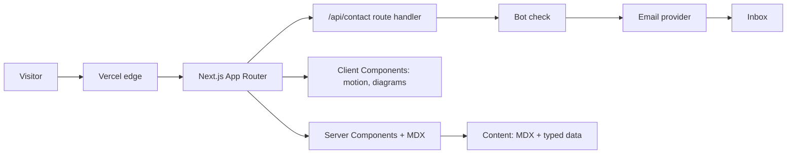

# 12 — Technical Architecture

**Objective.** A lightweight, maintainable implementation architecture for the HafTech site.
**Status:** `PROPOSED`. The brief's preferred stack is evaluated, not blindly accepted. Version numbers are intentionally omitted: pin the current stable releases at project start and verify against official docs.

## 12.1 Stack evaluation
| Choice | Verdict | Reasoning |
|---|---|---|
| Next.js App Router + React + TypeScript | **Accept** | Server Components give fast, SEO-friendly HTML; good fit for Vercel; strong ecosystem |
| Tailwind CSS | **Accept, with constraint** | Fast for layout; keep design tokens in CSS variables as the source of truth; avoid utility sprawl in complex components (use CSS modules or component classes where clearer) |
| Custom CSS tokens | **Accept** | Needed for the design system and PDFs/docs parity |
| GSAP + ScrollTrigger | **Accept** | Mature; free for commercial use per current licence; load only on pages that need it |
| Three.js / R3F | **Defer** | No launch concept needs 3D (doc 10); add only with a performance case |
| SVG / Canvas | **Accept** (SVG primary) | Accessible, crisp |
| MDX or structured content | **Accept: MDX for prose, typed JSON/TS for project data** | Git-based, no CMS needed |
| Vercel | **Accept** | Preview deployments, edge network, simple |
| Database / auth / admin dashboard | **Reject for launch** | No demonstrated requirement; revisit only when needed (doc 16) |

## 12.2 System architecture
See `DIAGRAMS/system-architecture.mmd`.


## 12.3 Server and client boundaries
- **Default to Server Components.** Pages, layouts, headers/footers, project lists, MDX rendering, JSON-LD.
- **Client Components only for interactivity:** `SiteNav` (menu state), `TextReveal`, `ImageMask`, `LineDrawing`, `ArchitectureExplorer`, `MethodologyScroll`, `ContactForm`.
- Client islands receive plain serialisable props; GSAP is imported only inside client components and via dynamic import where heavy.

## 12.4 Directory structure
```
haftech-site/
├─ app/
│  ├─ layout.tsx            # fonts, tokens, metadata base
│  ├─ page.tsx              # homepage
│  ├─ work/ page.tsx, [slug]/page.tsx
│  ├─ projects/ page.tsx, [slug]/page.tsx
│  ├─ services/page.tsx  approach/page.tsx  founder/page.tsx
│  ├─ journal/ page.tsx, [slug]/page.tsx
│  ├─ contact/page.tsx   privacy/page.tsx   not-found.tsx
│  ├─ api/contact/route.ts
│  ├─ sitemap.ts  robots.ts  opengraph-image.tsx
├─ components/
│  ├─ layout/ SiteNav.tsx SiteFooter.tsx
│  ├─ sections/ Hero.tsx Philosophy.tsx SelectedWork.tsx Capabilities.tsx Methodology.tsx FounderIntro.tsx ClosingCta.tsx
│  ├─ viz/ ArchitectureExplorer.tsx RequestTrace.tsx LayerList.tsx
│  ├─ motion/ TextReveal.tsx ImageMask.tsx LineDrawing.tsx tokens.ts useReducedMotion.ts
│  ├─ ui/ Button.tsx MetaTable.tsx StatusTag.tsx Field.tsx
├─ content/
│  ├─ projects/*.json (or .ts)   # typed per schema (doc 07)
│  ├─ case-studies/*.mdx
│  └─ journal/*.mdx
├─ lib/ content.ts schema.ts seo.ts email.ts
├─ styles/ tokens.css globals.css
├─ public/ fonts/ images/
├─ tests/ e2e/ unit/
└─ .github/workflows/ci.yml
```

## 12.5 Component hierarchy
See `DIAGRAMS/component-architecture.mmd`. Layout → Nav/Page/Footer; Page → sections; Selected work → ProjectFeature → EditorialMeta + ImageMask; Visualization → LayerStack + RequestFlow + DetailPanel.

## 12.6 Content architecture
- **Project data:** typed objects validated with a schema library (e.g. Zod) at build time using the schema in doc 07; build fails on invalid or unverified published items.
- **Case studies and articles:** MDX with front matter (title, date, summary, tags). Custom MDX components for figures, callouts, code and architecture explorer embeds.
- **Single source of truth:** content in Git; no CMS at launch.

## 12.7 Project publishing workflow
See `DIAGRAMS/content-workflow.mmd`. Draft → fill schema → verify facts and contributions → PR → CI → Vercel preview → review → merge → deploy.

## 12.8 Fonts
`next/font/local` for Monaspace Neon (OFL, self-hostable) and Boska (Fontshare terms: confirm self-hosting is permitted). Switzer: use Fontshare's hosted stylesheet or obtain ITF written consent before self-hosting (doc 03). Subset to Latin, preload display and body weights, `font-display: swap`, metric-adjusted fallbacks via `size-adjust`.

## 12.9 Images
`next/image`, AVIF/WebP, explicit dimensions, `sizes` per layout, `priority` only for the LCP image, blur placeholders for large images; source images kept at ≤ 2400 px wide.

## 12.10 Animation architecture
`motion/tokens.ts` holds durations/easings; `useReducedMotion` hook wraps `gsap.matchMedia()`; every animation runs inside `useGSAP`/`gsap.context` with cleanup; ScrollTrigger registered once in a client `MotionProvider`; `ScrollTrigger.refresh()` after fonts load.

## 12.11 SEO and metadata
Next.js Metadata API per route; `generateMetadata` for dynamic routes; `app/sitemap.ts`, `app/robots.ts`; Open Graph images generated per project/article; JSON-LD components for Organization, WebSite, Person, Article, CreativeWork (doc 14).

## 12.12 Analytics
Privacy-friendly option (for example Vercel Web Analytics or Plausible) loaded after interaction/idle; event tracking limited to CTA clicks and form submissions; no cross-site tracking at launch, so no cookie banner is needed if the chosen tool is cookieless (verify against applicable law — `OPEN`).

## 12.13 Contact form and email
- **Route handler** `POST /api/contact`: validate input (schema), honeypot field, invisible bot check (e.g. Cloudflare Turnstile), rate limit per IP (edge KV or in-memory fallback), send through a transactional email provider (e.g. Resend or Postmark) to the HafTech inbox, return generic success/error.
- **No database.** Submissions live in email. Add a persistent store only if volume demands it.
- Fallback: visible `mailto:` link and email address.

## 12.14 Security
Security headers (CSP, `X-Content-Type-Options`, `Referrer-Policy`, `Permissions-Policy`, HSTS via Vercel/Domain), strict input validation and output encoding, no secrets in client code, dependency audit in CI, least-privilege API keys, SPF/DKIM/DMARC (doc 14), minimal third-party scripts.

## 12.15 Environment variables
| Variable | Scope | Purpose |
|---|---|---|
| `EMAIL_API_KEY` | Server | Email provider key |
| `CONTACT_TO_EMAIL` | Server | Recipient inbox |
| `CONTACT_FROM_EMAIL` | Server | Verified sender |
| `TURNSTILE_SECRET_KEY` | Server | Bot-check verification |
| `NEXT_PUBLIC_TURNSTILE_SITE_KEY` | Public | Bot-check widget |
| `NEXT_PUBLIC_SITE_URL` | Public | Canonical base (https://haftech.com once confirmed) |
| `NEXT_PUBLIC_ANALYTICS_ID` | Public | Analytics identifier (if used) |

## 12.16 Deployment
See `DIAGRAMS/deployment-workflow.mmd`. GitHub → PR → CI (typecheck, lint, schema, unit) → Vercel preview → e2e + axe + Lighthouse CI → merge → production. Preview URLs are `noindex`.

## 12.17 Testing
| Layer | Tool (recommended) | Scope |
|---|---|---|
| Types and lint | `tsc`, ESLint | Every PR |
| Schema validation | Zod script | Content integrity |
| Unit | Vitest | Utilities, form validation |
| E2E | Playwright | Navigation, form, explorer keyboard/touch flows |
| Accessibility | axe via Playwright | Zero serious/critical |
| Performance | Lighthouse CI + RUM | Budgets (doc 13) |

## 12.18 Risks and trade-offs
| Risk | Mitigation |
|---|---|
| Animation weight harms performance | Budgets, lazy loading, reduced-motion paths |
| Licensing of Switzer self-hosting | Use Fontshare API or obtain written consent; have Inter fallback |
| Content depends on unverified facts | `verified` gate in CI |
| Over-engineering | No DB/auth/admin until a requirement exists |

## 12.19 Acceptance criteria
Repository builds with zero type errors; content schema enforced; Server Components by default; client JS limited to islands; all environment variables documented; preview and production pipelines operational.
